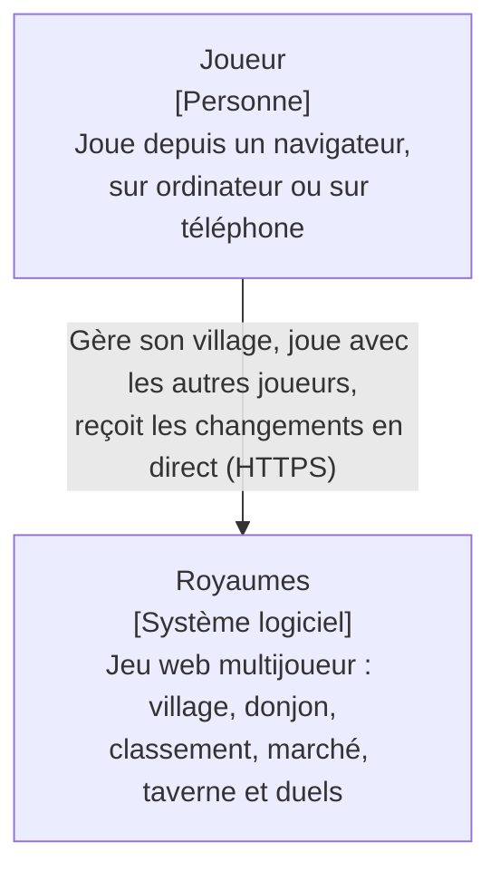
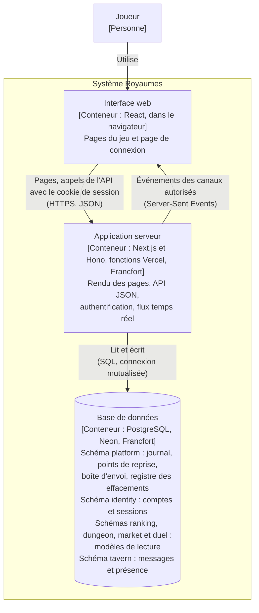
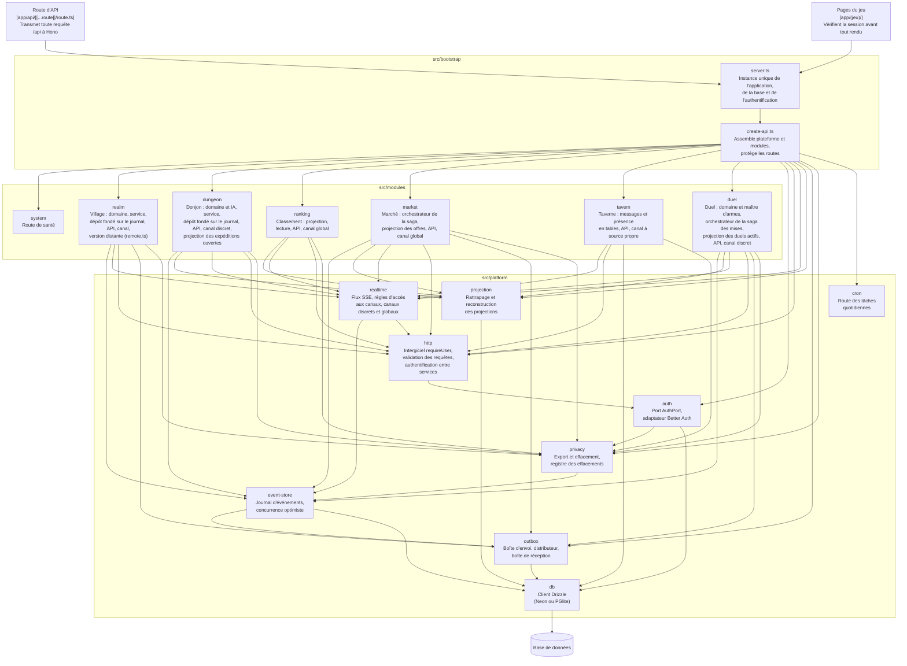
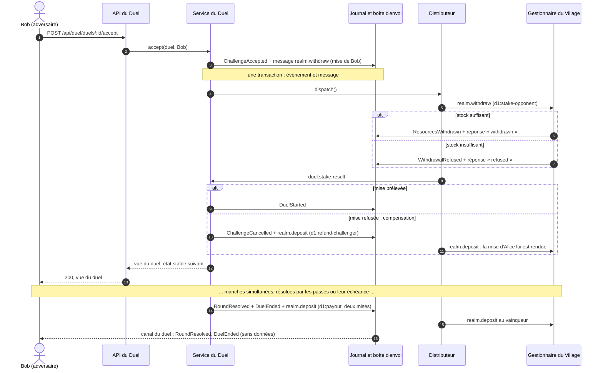
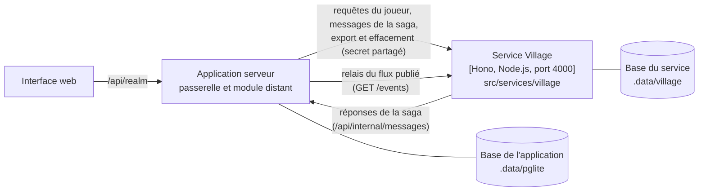
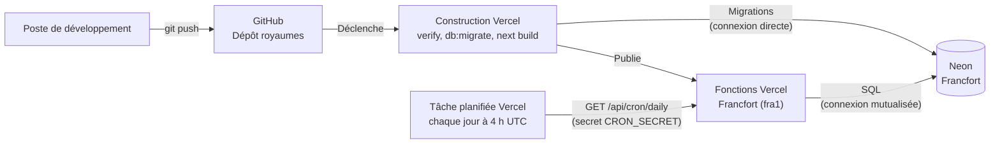

# Architecture de Royaumes

Ce document décrit la structure du système selon le modèle C4, du plus général au plus
détaillé. Les raisons des choix qui y apparaissent sont consignées dans les
[décisions d'architecture](adr/README.md).

Les diagrammes sont rédigés en Mermaid : ils sont versionnés avec le code, et mis à jour
dans le même commit que la modification qu'ils décrivent.

## Niveau 1 - Contexte

Royaumes ne dépend d'aucun système externe : il n'envoie aucun courrier électronique et
ne fait appel à aucun service de paiement ni à aucun fournisseur d'identité. Les comptes
des joueurs sont gérés par le système lui-même.

## Niveau 2 - Conteneurs

| Conteneur | Technologies | Responsabilités |
| --- | --- | --- |
| Interface web | React, composants des modules (`ui.tsx`) | Affichage des vues, envoi des actions du joueur, abonnement aux canaux temps réel |
| Application serveur | Next.js, Hono, Better Auth, Drizzle | Contrôle d'accès, règles du jeu, enregistrement des événements, diffusion des flux |
| Base de données | PostgreSQL (Neon en production, PGlite en local et en test) | Conservation du journal d'événements, des comptes et des sessions ; modèles de lecture des modules |

Le journal d'événements est la seule source de vérité des modules Village, Donjon, Marché et Duel.
La Taverne n'enregistre pas d'événements : ses tables sont sa propre source de vérité (ADR 0008).
Les tables des schémas `ranking`, `dungeon`, `market` et `duel` sont des modèles de lecture, dérivés du journal par des projections : elles peuvent
être vidées puis reconstruites à tout moment, sans perte d'information.

L'interface web ne communique jamais directement avec la base : toute lecture et toute
écriture passent par l'application serveur, qui applique le contrôle d'accès.

## Niveau 3 - Composants de l'application serveur

Les interfaces des modules (`ui.tsx`) s'appuient sur la couche 3D partagée, `src/ui/three/`
(canevas, décors, personnages, effets, étiquettes), et sur les scènes de leur propre répertoire
`scene/`. Ces scènes sont chargées à la demande dans le navigateur, et ne reçoivent que les vues
renvoyées par l'API : elles ne font partie que de la présentation (ADR 0013). Elles ne figurent pas
sur le diagramme, qui décrit l'application serveur.

Une flèche signifie « dépend de ». Le diagramme ne montre que les dépendances principales :
`server.ts` crée également lui-même la base, le journal et l'adaptateur d'authentification,
qu'il transmet à `create-api.ts`. Les modules `dungeon` et `ranking` écrivent directement
dans leurs propres tables, au sein de la transaction fournie par le moteur des projections.

Le module `ranking` lit des événements du Village et du Donjon, mais n'importe aucun de leurs
fichiers en dehors de leurs contrats : il ne dépend que de leur langage publié, c'est-à-dire
du nom et des données de leurs événements, ainsi que du préfixe de leurs flux.

Le module `market` modifie les villages sans jamais importer le code du Village : il enregistre
des messages dans la boîte d'envoi, que le distributeur remet aux gestionnaires du Village.
La seule dépendance directe porte sur les contrats du Village (`REALM_TOPICS`, `ResourceAmounts`),
qui décrivent ces messages. Chaque transaction ne modifie que les données d'un seul module,
et la boîte d'envoi (ADR 0007).

Le module `duel` communique lui aussi avec le Village par la boîte d'envoi, sans importer son
code (ADR 0011). Il réutilise les sujets publiés par le Village, `realm.withdraw` et
`realm.deposit`, et reçoit les réponses aux prélèvements sur son propre sujet,
`duel.stake-result`. L'offre du Marché et le duel sont ainsi deux orchestrateurs de saga
indépendants, qui s'adressent au même gestionnaire du Village. Le Village n'a pas été modifié
pour accueillir le Duel. La seule dépendance du Duel envers lui porte sur ses contrats
(`REALM_TOPICS`), et une fonction d'aptitude vérifie que les ressources misables par le Duel
restent celles du Village. L'interface du Duel lit en outre la liste des joueurs dans le langage
publié du Classement (`GET /api/ranking/players`), pour proposer des adversaires.

Chaque module déclare ses données personnelles à la brique `privacy`, au moyen d'un fichier
`personal-data.ts` : il les exporte, désigne les champs personnels de ses événements, et les
efface de ses tables. La brique `privacy` contient la seule fonction du projet qui modifie un
événement enregistré : la réécriture ciblée des champs personnels, lors de la suppression
d'un compte (ADR 0008).

Les règles suivantes sont vérifiées automatiquement par
dependency-cruiser (`.dependency-cruiser.cjs`) à chaque exécution de `pnpm verify` :

- la plateforme ne dépend d'aucun module ;
- un module n'est accessible que par ses entrées publiques (`index.ts`, `contracts.ts`, `ui.tsx`) ;
- le domaine d'un module ne dépend d'aucune bibliothèque technique ;
- la couche application d'un module ne dépend pas de sa couche infrastructure ;
- le code destiné au navigateur ne dépend d'aucun code serveur ;
- aucune dépendance circulaire n'est admise ;
- un module n'importe jamais les tables de la plateforme : il passe par ses fonctions.

Trois fonctions d'aptitude complètent ces règles, sous la forme de tests
(`src/bootstrap/architecture.test.ts`) : chaque table est rangée dans le schéma d'une brique
de la plateforme ou d'un module, chaque module qui conserve des données déclare ses
données personnelles, et les ressources misables dans un duel sont exactement celles du
Village (ADR 0012).

Seule la racine de composition connaît à la fois la plateforme et l'ensemble des modules.

## Parcours d'un duel entre deux modules

Le diagramme suivant présente l'acceptation d'un défi, puis la fin du duel. Il traverse le Duel,
la boîte d'envoi de la plateforme et le Village (ADR 0011). Chaque rectangle `Note` est une
transaction locale à un module.

Une réponse ou un versement remis deux fois n'ont d'effet qu'une fois : l'identifiant du
mouvement, déterminé par le duel et l'étape, sert de clé d'idempotence au Village, et le Duel
ignore une réponse qui ne correspond pas à l'étape en cours.

## Extraction du Village

Le Village peut s'exécuter dans un service autonome, distinct de l'application serveur
(ADR 0009). Cette configuration n'est utilisée qu'en local, lorsque les variables
`REALM_SERVICE_URL` et `SERVICE_SECRET` sont définies ; elle n'est pas déployée.

L'application reçoit alors une version distante du module Village (`remote.ts`), de même
forme que la version exécutée dans le processus : le reste de l'application ne voit pas la
différence. Le relais recopie les événements publiés par le service dans le journal de
l'application, où le Classement et le canal temps réel du village continuent de les lire.
Le service est assemblé par sa propre racine de composition, `src/services/village`, qui
n'utilise le module Village que par son point d'entrée public.

## Niveau 4 - Code

Ce niveau n'est pas dessiné : il est décrit par le code lui-même et par ses tests, que
tout diagramme maintenu à la main ne tarderait pas à contredire.

## Déploiement

Chaque envoi sur la branche `main` déclenche un déploiement. Le code n'est publié que si
l'ensemble des contrôles a réussi, et les migrations ne sont appliquées qu'après ces contrôles.

La tâche planifiée, déclarée dans `vercel.json`, exécute chaque jour les tâches quotidiennes :
la distribution des messages restés en attente dans la boîte d'envoi, et l'application des
durées de conservation de la Taverne. Elle ne s'exécute que sur le déploiement de production.

Le service Village extrait n'est pas déployé : en production, le Village s'exécute dans
les fonctions Vercel, comme les autres modules (ADR 0009).